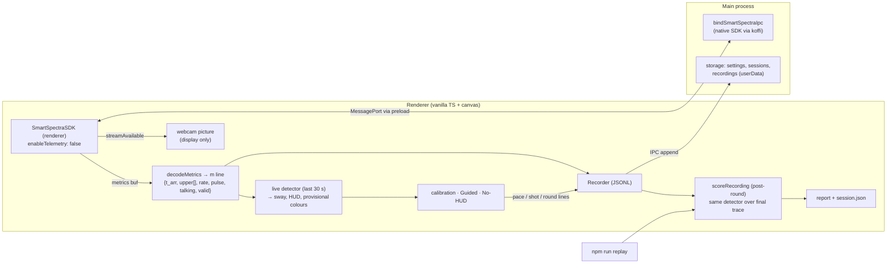

# STEADY

**Your breathing moves the crosshair, the way it moves a rifle. Fire in your natural respiratory pause, where the sway stops, measured live by your webcam.**

A seated breath-timing trainer for rifle and pistol shooters (air rifle and air pistol especially), built on the Presage SmartSpectra SDK for the DEV Presage SmartSpectra Challenge. The live chest-breathing trace from the webcam moves the crosshair, and it decides whether each shot was fired in the pause.

> Training aid for breath timing. Not a medical device; not for diagnosis. Seated desk practice only, not a real shooting stance.

## Setup

Requires macOS on Apple Silicon (or another SDK-supported platform), Node 22.6+ and a webcam.

```bash
npm install
cp .env.example .env          # paste your key after PRESAGE_API_KEY=  (free at physiology.presagetech.com)
npm start
```

Without a key the app starts on a "Set PRESAGE_API_KEY in .env" screen, and you can still use Replay.

| Command | What it does |
|---|---|
| `npm start` | Build and launch the app |
| `npm test` | Unit tests (`node:test`) for the detector, calibration, sway, scoring, insights, recorder, spike summary and storage |
| `npm run typecheck` | `tsc --noEmit` |
| `npm run replay -- <file.jsonl> [--out session.json]` | Detector → sway check → scoring → report on a recording. No camera, no key |
| `npm run spike` | The day-1 spike in front of the camera (≈ 3.5 live minutes); writes `recordings/spike-*.jsonl` and prints a go/degrade/no-go summary |
| `npm run spike:summary -- <file.jsonl>` | Re-print a spike summary |
| `npm run fixtures` | Regenerate the synthetic test recordings (seeded) |

Screen previews for development (no camera, no key, no SDK, throwaway profile): `npm run build && STEADY_PREVIEW=guided STEADY_SNAPSHOT=out.png npx electron .` renders one screen from the synthetic fixtures with an autopilot and saves a screenshot. Screens: `missing consent home replay report settings warmup sync calibrated guided guided-talking nohud-intro nohud spike spike-result`; `STEADY_SNAPSHOT_WAIT=ms` sets the capture delay. Captures live in `docs/screenshots/`.

Try it without a camera: `npm run replay -- test/fixtures/synthetic-talking.jsonl`. These fixtures are **synthetic test data** (generated, not a person) and are labelled that way in the app and the CLI.

## How it works

1. **Consent** (before the camera opens): what is measured, what is stored, what leaves the device.
2. **Calibration (≈ 45 s):** warm-up until the SDK reports a valid signal for 5 s, then 3 paced breaths (4 s in, 4 s out, 2 s rest) following an animated circle. From the scheduled pacer timestamps STEADY computes the trace orientation, your breath amplitude `A`, your breath period, the **timing offset `L`** and the **delivery delay `D`**.
3. **Guided round (60 s):** targets appear one at a time (8 s each). You aim with the mouse; the crosshair is offset by your chest position. Any key or mouse button fires (a presenter clicker works as a trigger). The HUD shows the breathing waveform with the pause shaded green, a NOW marker and a soft tick.
4. **No-HUD round (60 s):** same sway and scoring, no shading, NOW or tick. The No-HUD pause rate is the headline training number.
5. **Report:** the breathing curve of each round with every shot as a green (in pause), red (mid-breath) or grey (not scored) dot, Guided vs No-HUD pause rate, and one rule-based coaching insight.

### Pause detection (`src/core/detector.ts`)
- Smooth the chest trace (200 ms centred moving average) and orient it so an inhale goes up.
- Keep a trailing 2-breath min/max model: trough level and amplitude `A`.
- A **pause opens** after an exhale when `|slope| < 0.15·A` per second for ≥ 300 ms **and** the level is in the bottom 30 % of `A`. The top of an inhale is also flat but fails the level test, so it never counts.
- It **closes** when the inhale starts, or after 5 s ("breathe again": a held breath is not a natural pause).
- Unstable samples, gaps over 500 ms, SDK-invalid spans and talking (+ 2 s) are **unknown**. Shots there are grey and not scored.

### Sway (`src/core/sway.ts`)
Position-based: `offset = clamp((x − trough) / A, 0, 1) × 42 px`, mostly upward like a rifle rising with the chest, plus a small fixed tremor. Zero at the trough (the pause), maximal at full inhale, so a shot in the pause really is more accurate. Metrics arrive in chunks, so the crosshair is drawn from the trace at `now − (D_p95 + 100 ms)` with linear interpolation, and the HUD states that delay. If the signal is invalid the sway freezes and the round pauses.

### Scoring (`src/core/scoring.ts`)
- Shot score = hit accuracy (0–100 from the swayed impact's distance to the target centre) × breath multiplier: **pause ×1.0, mid-breath ×0.3, unknown not scored**.
- A shot at wall time `t` is judged against the trace at `t + L`.
- Live colours are provisional. The **final score is always computed post-round** over the final trace by the same detector, so one scoring path serves live sessions and replays, and replay is deterministic by construction (tested byte-for-byte).
- Report numbers: % of scored shots in pause per round, average score, trigger patience (pause opening → shot), rhythm consistency (CV of trough-to-trough periods), pulse calm/elevated vs your own pre-round baseline, breathing rate (display only).

### Calibration numbers (`src/core/calibration.ts`)
- **`D` (delivery delay)** = median of (arrival wall-clock − sample timestamp) over all samples. No human in the loop. The SDK anchors frame timestamps to the wall clock, so this is directly comparable.
- **`L` (timing offset)** = median over the paced cycles of the lag that best cross-correlates the trace with the pacer waveform. It includes your pacer-following delay and the SDK's filter delay; it is a per-user offset, which is what scoring needs, not pure sensor latency. (The PRD's inhale-onset threshold was replaced: a threshold crossing lags by an amount that depends on inhale speed, about 0.8 s on a 4 s paced inhale; correlation against a symmetric ramp does not.)

## Architecture



| Path | Role |
|---|---|
| `src/core/*` | Pure TS, unit-tested: `recording` (format, trace assembly, recorder), `detector`, `calibration`, `sway`, `scoring`, `insights`, `spike`, `synth` (synthetic generator) |
| `src/main/main.ts`, `storage.ts`, `preload.ts` | Electron main: `.env` key, `bindSmartSpectraIpc`, local storage, camera-only permission; preload bundles Presage's bridge plus a narrow `window.steady` API |
| `src/renderer/*` | Screens: missing key, consent, home, warm-up, paced sync, rounds, report, settings, replay, D1 spike |
| `src/cli/*` | `replay`, `spike-summary` |
| `test/*`, `test/fixtures/synthetic-*.jsonl` | `node:test` suites and seeded synthetic recordings |

**What is new vs Presage's `electron-quickstart`:** the quickstart's pattern is kept (`bindSmartSpectraIpc` in main, the renderer builds the SDK, `decodeMetrics` in the `metrics` handler, the same camera-only permission handler). Replaced: the Chart.js dashboard by the game, calibration and report; the hard-coded key by `.env`; and the preload is bundled together with STEADY's own bridge. Added: recorder/replay, all of `src/core`, storage and consent.

### Recording format (`recording.jsonl`, all times ms)
```
{"k":"meta","v":1,"sdk":"3.5.x","t0_wall":…,"sdk_time_unit":"ms","cal":{"orient":±1,"A":…,"period_ms":…,"L_ms":…,"L_spread_ms":…,"D_ms":…,"D_p95_ms":…}}
{"k":"m","t_arr":<wall ms>,"upper":[{"t":<SDK µs/1000>,"v":…,"s":true}],"rate":…,"pulse":…,"talking":false,"valid":true}
{"k":"pace","phase":"in|out|rest","t":…,"dur":…}
{"k":"shot","t":…,"round":"guided|nohud","t_target":…,"target":[x,y],"mouse":[x,y],"offset":[dx,dy],"impact":[x,y],"t_disp":…,"accuracy":0-100,"live_state":"pause|breath|unknown"}
{"k":"round","type":"guided|nohud","t_start":…,"t_end":…}
{"k":"mark","name":"validation|status|hold_start|…","t":…,"detail":"…"}
```
Calibration runs before the file can start with its `meta` line, so the recorder buffers until calibration finishes and then writes `meta` first. Extra over the PRD: `pace`, `mark`, `t_target`, `offset`, `t_disp`, `D_p95_ms`.

## Data handling
- **Measured, on-device:** chest breathing trace, breathing rate, pulse rate, talking, face/position validity.
- **Stored locally only** (`~/Library/Application Support/steady/steady/` on macOS): `settings.json`, `sessions/*.json` summaries and `recordings/*.jsonl` raw signal recordings. `npm run spike` writes to the repo's `recordings/`, which is gitignored.
- **Never stored:** video frames or images. The webcam picture is a `<video>` element fed by the SDK's stream; nothing reads its pixels. The dev-only `STEADY_SNAPSHOT` screenshot hook refuses to run while the webcam picture is on screen.
- **Shared with nobody.** No analytics, crash reporting or cloud.
- **Leaves the device:** Presage SDK key verification, usage metering and model download. SDK telemetry is set to `enableTelemetry: false` ([Presage telemetry page](https://smartspectra.presagetech.com/docs/telemetry-and-privacy)).
- **AI:** none in the app. The insight is rule-based (`src/core/insights.ts`). Presage's on-device models compute the signals. The code was written with Claude Code.
- **Delete:** Settings → Delete all data removes every session summary and raw recording (tested in `test/storage.test.ts`). Withdrawing consent stops the camera and offers the same deletion.
- The API key lives in `.env` (gitignored) and is never committed.

## What is real vs pending live verification
| Item | Status |
|---|---|
| Detector, calibration, sway, scoring, insights, recorder, replay | Implemented and unit-tested, **on synthetic data only** |
| Replay CLI and in-app Replay | Working, deterministic (tested) |
| Missing-key screen, consent, report, replay screens | Rendered and checked in Electron |
| Live SDK path (auth, metrics decoding, talking, pulse, validation, telemetry off, webcam picture) | Implemented against SDK 3.5.0 docs and types, **pending live verification** (see `docs/VERIFY_D1.md`) |
| Measured `D`, `L`, cadence, detector agreement on real recordings | **Not measured yet**; `npm run spike` produces them |
| Bundled real recordings (clean + talking) | **Not recorded yet**; only synthetic fixtures ship |

## Limitations
- Seated, front-facing, still and silent only: the SDK needs one still face in even light. Not for a real shooting stance.
- Displayed sway lags real breathing by the measured delivery delay; the HUD states it.
- `L` includes your pacer-following delay, so it is a per-user offset, not sensor latency.
- Detector thresholds are first guesses tuned on synthetic traces; they will be retuned on real recordings.
- About 2.75 live minutes per session, so ≈ 18 sessions per free key.
- Apple Silicon is the tested target (the SDK also ships Linux and Windows runtimes).
- Rifle/pistol natural-respiratory-pause technique only; archery's partial-exhale hold is not modelled.
- Talking breaks the breathing signal; those shots are greyed, never guessed.

## Licence notes
`@smartspectra/node-sdk` is Presage's proprietary SDK, installed from npm and used under its licence. No Presage source is copied into this repository.
